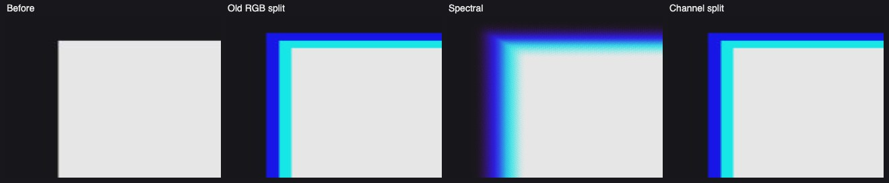
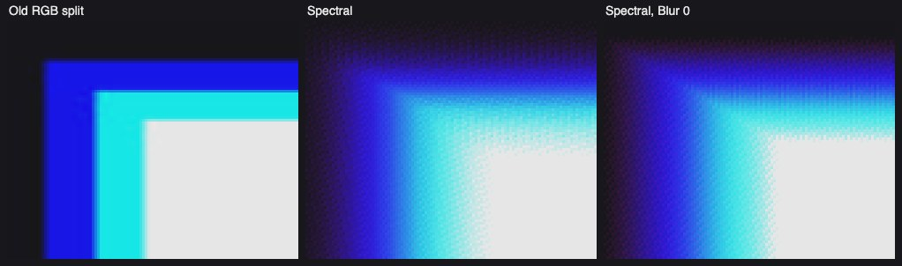
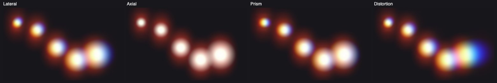

# Chromatic Aberration

A lens bends each wavelength a little differently, so the colours of an edge don't land in the same
place. The old effect copied the picture three times (red one way, blue the other) and showed three
hard-edged copies. This one reads the picture at many taps across the spectrum, so edges fringe in
smooth rainbow gradients, and it can soften each colour by how far it moved.

One implementation, in three places:

| Where | What | Code |
| --- | --- | --- |
| Studio graph | the **Chromatic Aberration (lens)** node (Passes; found as *Chromatic aberration*, *Dispersion*, *Prism*, *Colour fringe*, *RGB split*) | `src/nodes/definitions/chromaLens.ts` |
| Builders' Effects page | the **Chromatic aberration** card (builds that node) | `src/builders/look/effects.ts`, see [builder-look.md](builder-look.md) |
| Play → Finish | the **Chromatic aberration** effect (Lens & screen) | `src/play/kit/finish.js` (`chroma`: what the first pass reads), see [finish-stack.md](finish-stack.md) |

All three run the GLSL in **`src/play/kit/chroma.js`** (`CA_BASE_GLSL`, `caGlsl`). It is part of
the layer kit, so web exports carry it (in the Blur group, which Finish already needs).

The picture is `docs/finish-stack/halation-scene.jpg`, cropped to 16:9 at 1920 × 1080; Amount 12
pixels (Distortion: 4), Samples 12 (Prism 16), Blur 0.3 unless named.

## How it works

**Spectral** (the default) reads the picture at N taps (3–16, Samples) spread from red to violet.
Tap *t* (0 red, 1 violet) is shifted by (1 − 2t) × `CA_SPREAD` × the shift: red one way, violet
the other, green about still. Its colour weight comes from a smooth spectrum (`caSpec`: red,
through yellow, green and cyan, to blue, and violet with a little red), and each channel is divided
by its weights' sum, so the taps add up to white: a grey picture stays grey, and only edges fringe.
`CA_SPREAD` (≈ 1.75) is set so that the weighted middle of red's taps and of blue's sit exactly
±Amount apart, as Channel split's copies do: the same Amount moves the colours as far in both looks.

Each tap's wavelength is jittered per pixel inside its slice of the spectrum, so the gradient is
continuous: a fine grain, never bands or copies.

**Channel split** is three taps: red at +Amount, green still, blue at −Amount. With Blur 0 it is the
old node's maths exactly.

**Geometry**

- **Lateral**: the shift points away from the Centre and grows with the distance r (half picture
  heights) as r^Falloff: 0 the same everywhere, 1 in step with the distance, 2 mostly at the edges.
  Amount is the shift at the top and bottom edge (r = 1).
- **Axial**: nothing moves. Each colour is out of focus by Amount × its distance from green along
  the spectrum, so highlights get a coloured defocus halo.
- **Directional / Prism**: every pixel spread the same way, along Angle (degrees, 0 right, 90 up).

**Dispersion blur**: each tap is read over a small disc of radius Blur × its shift (plus Axial's
defocus), turned per pixel in golden-angle steps, so the far colours melt into the picture while
green stays sharp. A tap that blurs more than half a pixel is read twice (`CA_SUB`), stratified
across its slice; one that barely blurs is read once.

**Distortion** scales each colour about the Centre by 1 + 0.02 × Distortion × r² × its shift: a
barrel per colour (red bulges out, violet in), growing with the square of the distance. 0 is off.

## Controls

| Control | Node | Builders' card | Finish |
| --- | --- | --- | --- |
| Look | Spectral / Channel split | `look=spectral\|split` | Look (Spectral, Channel split) |
| Geometry | Lateral / Axial / Directional | `mode=radial\|axial\|directional` (Direction) | Geometry |
| Amount | pixels (0–40) | pixels | 0–1: 1 moves red 0.018 of the picture's height at the corner, as before |
| Samples | 3–16 (12) | `samples=` | Samples |
| Blur | 0–2 (0.3) | `blur=` | Blur |
| Falloff | 0–3 (1), Lateral | `falloff=` | 0.5–4 (1.6), as before |
| Centre | Centre socket (picture coordinates) or Centre X / Y | `cx=`, `cy=` | Centre X / Y, 0–1 |
| Angle | degrees, Directional | `angle=` | Angle |
| Distortion | −1–1 (0) | `distortion=` | Distortion |

Every number on the node is wireable (#829), and Centre has a socket of its own: wire Mouse UV to
aim the lens. Finish's presets: **Lens** (the defaults), **Cheap lens**, **Prism**, **Halo** (Axial)
and **RGB split** (Channel split, Directional, Blur 0).

## Old graphs, scenes and stacks

- The old **Chromatic Aberration (texture)** node (`chromaTexture`, later RGB Split (texture)) opens as this
  node's Channel split with Blur 0 since 2026-10-17 (the same three reads; [node-retirements.md](node-retirements.md)).
  Chroma Shift and the UV-offset Chromatic Aberration are hidden (saved graphs still load).
- The builders' card now builds the new node. Its keys are unchanged (`chroma 6 mode=directional
  angle=30` still reads: Direction is the Geometry, Radial is Lateral), and Amount keeps its pixels,
  so an old recipe fringes as far, now with spectral fringes. New keys: `look`, `blur`, `samples`,
  `distortion`, `cx`, `cy`.
- Finish's effect keeps Amount and Falloff with their old scale; a saved stack loads with its numbers
  and the new controls at their defaults (Spectral, Lateral, Blur 0.3).

## Cost

Measured with timer queries on an Apple M3 Pro (ANGLE Metal), one full-screen pass at 1920 × 1080:

| Setting | ms |
| --- | --- |
| Old RGB split | 0.06 |
| Channel split, Blur 0 | 0.04 |
| Spectral, 12 samples, Blur 0 | 0.36 |
| Spectral, 12 samples, Blur 0.3 (the default), Amount 4 / 12 | 0.85 / 1.07 |
| Spectral, 16 samples, Blur 0.3 | 1.2 |
| Axial, 12 samples | 0.85 |

Fewer Samples or Blur 0 are the ways to save time; Channel split costs what the old split did.

## Tests

`src/compiler/__tests__/chromaLens.test.ts`: the weights sum to white for every tap count and a grey
row stays grey, the spectrum runs red → violet with mixed in-between taps, the spread matches Channel
split's, the shift by geometry and Falloff, the blur grows with the shift, the node compiles in every
look and geometry (and wired), the old node still compiles, the builders' card builds the new node,
old recipes map onto it with the same Amount and the recipe round-trips, Finish's old stacks load with
their numbers, and its shader parses in every look and geometry, with Glitch's split and after a stage.
