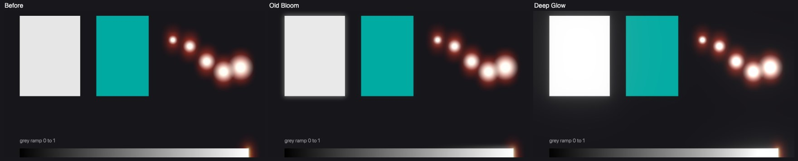
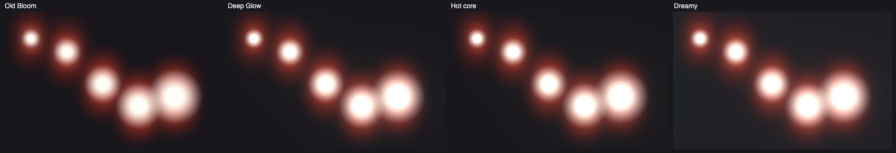
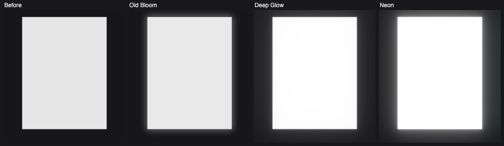

# Deep Glow

A bloom modelled on After Effects' **Deep Glow**: bright parts get a hot core and a long, natural
tail, not one soft disc. It replaces the old **Glow** on the builders' Effects page and **Bloom** in
Play's Finish. One implementation, in three places:

| Where | What | Code |
| --- | --- | --- |
| Studio graph | **Glow (texture)**, Method **Deep glow** (Passes; found as *Deep Glow*, *Bloom*, *Glow*; a saved Deep Glow (texture) opens as it since 2026-10-17) | `src/nodes/definitions/deepGlow.ts`; hidden passes in `src/compiler/blurPasses.ts` (`planDeepGlow`) and `hiddenBlurs.ts` |
| Builders' Effects page | the **Deep Glow** card (builds that node) | `src/builders/look/effects.ts`, see [builder-look.md](builder-look.md) |
| Play → Finish | the **Deep Glow** effect (Film) | `src/play/kit/finish.js` (`deepglow`, `deepGlowPass`), see [finish-stack.md](finish-stack.md) |

All three run the GLSL in **`src/play/kit/deepglow.js`** (`DG_BASE_GLSL`, `dgGlsl`). It is part
of the layer kit, so web exports carry it (in the Blur group, which Finish already needs). This is not
the Combiners' **Deep Glow** node, which glows an SDF shape.

The picture is `docs/finish-stack/halation-scene.jpg`, cropped to 16:9 at 1920 × 1080.

## How it works

1. **Threshold**: the picture is halved with a dual-filter downsample (the point × 4 and four
   diagonal reads, ÷ 8). Each read keeps only what is over Threshold, measured on its brightest
   channel, with a soft **Knee** (Unity's curve: a quadratic up to Threshold + Knee, then linear), so
   the glow fades in without an edge. In Finish this is done in linear light.
2. **Down**: halved again and again to `DG_LEVELS` = 8 levels, ½ … 1/256 of the source, each one a
   dual-filter downsample. A level that would be smaller than 1/256 of the picture is dropped.
3. **Up**: from the smallest back to the half-size level. Each step upsamples the level below with a
   Kawase dual-filter tent (8 reads) and adds this level × its weight.

Every level is a blur about twice as wide as the one before, so the sum is many radii at once. The
weights fall off exponentially: each level weighs 2^−0.4 (×0.76) of the one before, out to the level
whose blur reaches **Radius**, then they fade out over one more level. The core (level 1) always
counts. The sum is divided by the weights' total, so a wider Radius adds tail without making the
whole glow brighter. That gives a hot core and a long tail.

**Chromatic spread** moves red's reach one level further at 1 and blue's one level less, so the edges
warm round a white core. **Preserve colour** 1 keeps the glow the colour of what glows; 0 lets the
hot core go white (mixed toward its brightest channel by 1 − e^(−1.5 × brightness)). **Composite** is
Add (light adds up and can pass white) or Screen (never past white). Tint multiplies the glow.

All targets are half float where the GPU allows it, so what is brighter than white glows brighter.

## Controls

| Control | Node | Builders' card | Finish |
| --- | --- | --- | --- |
| Radius | picture pixels (1–800, 120) | `radius=` | pixels of a 1080p picture (4–800, 120) |
| Intensity | 0–8 (1) | the bare number: `fx deepglow 1.5` | 0–4 (1) |
| Threshold | 0–2 (0.6) | `threshold=` | 0–1.5 (0.6) |
| Knee | 0–1 (0.3) | `knee=` | Knee |
| Chromatic spread | 0–1 (0) | `spread=` | Chromatic spread |
| Preserve colour | 0–1 (0.5) | `preserve=` | Preserve colour |
| Tint | colour | `tint=#…` | Tint |
| Composite | Add / Screen | `composite=add\|screen` | Add / Screen |

Every number and the tint can be wired on the node (#829), and every hidden pass computes the wire.
Finish's presets are **Deep glow** (the defaults), **Subtle**, **Neon**, **Hot core** and **Dreamy**.

Where hidden passes can't go (a group without a Pass, an Agents program, a repeated Pass that reads
itself, or past the hidden-pass budget), the node draws a grainier glow in one pass: 32 reads on a
spiral out to Radius (`dgSingle`).

## Old scenes and stacks

- **Builders:** the Glow card is retired. It is not offered any more, but a scene that has one keeps
  it and builds it unchanged (Glow (texture), Bloom chain, then Add), and `fx glow …` still reads and
  prints. The card shows **Upgrade to Deep Glow**, which swaps it in place (same id, place and on/off)
  for a Deep Glow with its Intensity and Threshold and 4 × its Radius
  (`StackKindDef.retired`, `stackUpgrade`).
- **Finish:** Bloom is retired (`FN_RETIRED`). It is out of the Add menu (`FN_OFFERED_KINDS`), but a
  stack that has it loads and draws it as before. Its card shows **Upgrade to Deep Glow**
  (`fnUpgradeEffect`), which keeps its id, on/off and Where, with Intensity = 1.5 × Amount, the same
  Threshold and Tint, and a Radius of 60–400 pixels from its 0–1 Radius.
- **Studio:** the old **Glow (texture)** node stays in the library and compiles as before.
- Surprise me now adds a Deep Glow where it used to add a Glow.

## Cost

Measured with timer queries on an Apple M3 Pro (ANGLE Metal) in Play's Finish at 1920 × 1080, the
median of 7 × 40 frames, over a stack with only an empty vignette:

| Effect | ms |
| --- | --- |
| Old Bloom | 0.50 |
| Deep Glow (defaults; Add or Screen) | 0.89–0.91 |
| Deep Glow presets (Hot core, Dreamy, Neon) | 0.93–1.03 |

That covers the chain's 15 small passes and the extra full-size pass Deep Glow heads in Finish. The
cost doesn't depend on Radius: the chain always has the same passes. The node's hidden passes are the
same chain (`2 × levels − 1` = 15 at a full-size source, 13 at a half-size Pass).

## Tests

`src/compiler/__tests__/deepGlow.test.ts` covers:

- the levels and the pass count (15, or 13 from a half-size source), and the plan's reads and scales;
- the weights' exponential falloff and cut-off, Chromatic spread, and the knee;
- the node compiling with its 15 half-float hidden passes in both composites, wired sliders, and the
  one-pass fallback;
- the old Glow (texture) still compiling;
- the Effects page offering Deep Glow instead of Glow, old Glow cards building unchanged, the upgrade,
  and the recipe round-trip;
- Finish offering Deep Glow instead of Bloom, old Bloom stacks loading and building, the upgrade, the
  pass Deep Glow heads, and the export kit.
