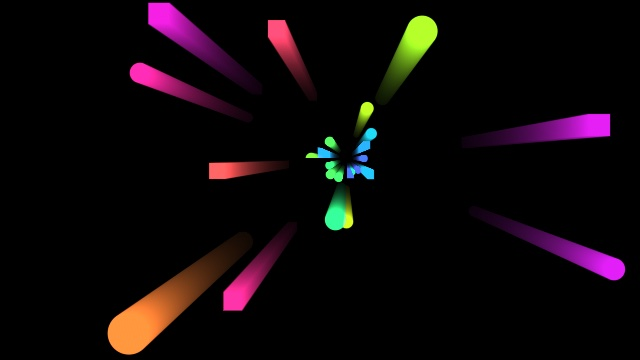

# Radial Fast Blur (Light rays)

Long zoom streaks and light rays made by blurring the picture along lines from a centre, in the
spirit of After Effects' **CC Radial Fast Blur**. One implementation, in three places:

| Where | What | Code |
| --- | --- | --- |
| Studio graph | the **Radial Fast Blur** node (Passes; found as *Light rays*, *God rays*, *CC Radial Fast Blur*, *Zoom blur (texture)*) | `src/nodes/definitions/radialFastBlur.ts`, hidden passes in `src/compiler/blurPasses.ts` (`planRays`) and `hiddenBlurs.ts` |
| Builders' Effects page | the **Light rays / Radial blur** card (builds that node) | `src/builders/look/effects.ts`, see [builder-look.md](builder-look.md) |
| Play → Finish | the **Light rays** effect (Film group) | `src/play/kit/finish.js` (`rays`, `raysPass`), see [finish-stack.md](finish-stack.md#light-rays) |

All three run the GLSL in **`src/play/kit/rays.js`** (`RF_BASE_GLSL`, `rfGlsl`): the log-step
pass, the threshold's knee, the falloff and the composite. It is part of the layer kit, so web
exports carry it (in the Blur group, which Finish already needs).

The older **Radial Blur** node (Effects) is unchanged: it reads last frame's picture and its
streaks stay short.

## Controls

| Control | What it does |
| --- | --- |
| Mode | **Average**: a zoom blur, the streaks in place of the picture. **Brightest**: the brightest colour along each streak (CC's light-ray mode), each read weighed by its fade before the max, screened over the picture by Opacity. **Add**: the streaks' light added over the picture (god rays). |
| Zoom | **Out** from the centre (the streaks fly outward: each pixel reads toward the centre) or **In** (they pull in toward it). |
| Length | How long the streaks are: the farthest copy is 1 + Length times bigger. 1 reads from half way to the centre; 3 and up is a light-speed burst. Long streaks cost the same. |
| Centre | Where the streaks come from. The node has a **Centre** socket (picture coordinates: wire Mouse UV or any point) and Centre X / Y sliders; Play's effect has Centre X / Y from 0 to 1, as Ripple's. |
| Threshold, Knee | Only parts brighter than Threshold streak, fading in over ±Knee (a smoothstep on the brightness). 0 streaks everything. |
| Intensity | How strong the streaks are. In Average, below 1 mixes the picture back. |
| Opacity | Brightest and Add: how much of the rays shows (default 0.6). Brightest is a screen, `orig + (1 − orig) · rays · Opacity`, so it only lightens and what is behind a ray shows through; Add adds `rays · Opacity`. Average ignores it. |
| Decay | How much each streak fades along its length. Average and Add: the far end weighs e^(−4 · Decay) of the near end. Brightest: a smooth tail that always fades out (below). |
| Falloff | How much the effect fades with the distance from the centre: e^(−4 · Falloff · d²), d in picture heights. |
| Tint | The streaks' colour. |

On the node every number and the tint is also a socket (#829): wire an LFO into Length, a
hand into Centre. The node's outputs are **Color** and **Alpha** (the picture with the streaks)
and **Rays** (the streaks alone, tinted, to add or screen over something else).

## Brightest's soft tail

Brightest used to take the plain max along the streak, so a ray held the full brightness of its
source and stopped dead where the streak ended, covering what was under it. Now:

- **Each read is weighed by a fade before the max**, `e^(−rate · t)` with t its distance along the
  streak (log units). At Length the weight is `e^(−(0.7 + 3 · Decay))`: half at Decay 0, 30 % at
  0.17, 11 % at the default 0.5.
- **The reads run on five Lengths** (`RF_TAIL_REACH`), so the fade isn't cut off: at the end it is
  3 % at Decay 0 and 0.2 % at 0.17. Length now says where the ray has faded to the weights above,
  not where it stops.
- **Composited as a screen** with **Opacity** (0.6 by default): `orig + (1 − orig) · rays · Opacity`.
  A white ray at 0.6 leaves 40 % of what is behind it, and a fading ray fades into the picture.
- Still exact across the passes: an exponential weight multiplies, and a max of weighted maxes is
  the weighted max of all 4096 reads. The tests check that the brightness behind a bright edge falls
  monotonically with no step, and that the pass-by-pass max equals the direct one.

**Older graphs and stacks** saved with Brightest pick this up as they load: Opacity takes its
default (0.6) and Decay keeps its number, which now sets the soft tail. So their rays get softer
and see-through. Set Opacity to 1 and Decay to 0 for the strongest rays. Average is unchanged.
Add only gains Opacity, which defaults to 0.6, so set it to 1 to get back the old brightness.

## Fast: the log-step zoom

A streak is the picture read at many scales about the centre: `c + (uv − c) · e^(−t)` for t from
0 to the span, `ln(1 + Length)`. Scaling about a point composes by adding the exponents, so:

- pass 0 averages **8** reads one step apart (step = span / 4095), from the source, keeping only
  what is over the threshold;
- pass 1 averages 8 reads of pass 0, **8** steps apart; pass 2, 64 apart; pass 3, 512 apart.

Together that is one average of **8⁴ = 4096** reads exactly one step apart, from 0 to the span,
for 32 reads a pixel. No gaps and no banding at any Length, and the cost doesn't grow with it.
The other modes compose the same way: **Brightest** is a max of maxes, and **Decay**'s weight
e^(−rate · t) multiplies across the passes (each pass's weights are normalised on their own,
and the sums factor), so a decayed average or max is exact too. The tests check both
(`rfOffsets`: 4096 evenly spaced offsets; the pass-by-pass decayed average against the direct one).

The passes are half float where the GPU can draw into it (all of the node's hidden passes; the
Finish effect falls back to 8-bit), and the result gets ±½ of an 8-bit step of noise so a long,
faint streak doesn't band on screen.

**Where hidden passes can't go** (a group without a Pass, an Agents program, a repeated Pass
reading itself, past the 48 hidden passes a graph may add) the node draws the streak in one pass
of 48 reads, each pixel starting at its own fraction of a step (interleaved gradient noise): grain
rather than copies.

## In the graph

The node takes any texture: a Pass, a Shader Texture, a Texture Input, a video. Its four streak
passes are hidden passes, exactly like Blur and Glow (texture)'s (see
[blur-and-glow.md](blur-and-glow.md#hidden-passes-compilerblurpassests-compilerhiddenblursts)):

- each is an internal `radialFastBlurStage` node with the node's own id, so a slider drag, a
  Play mapping or a keyframe drives all four with no recompile; a wired slider or Centre is
  computed again in each pass;
- they draw just before the first program that has the node, at the source's scale (a ½ Pass
  streaks at ½), and don't count towards the 8 Pass nodes; the Performance panel lists them as
  *Radial Fast Blur · streak 1/4* … *4/4*;
- the node itself reads the last one at its UV (wire a warp to bend the read) and composites it
  over the texture.

## Examples

In **Effects & Lens** (`src/store/raysExamples.ts`), each with a Play setup:

- **Light rays 1 · LIGHT**: the word in the Agent Builder's stroke font (one Expression Block line
  per stroke), orange with a white-hot core, into a Pass; Radial Fast Blur in Brightest with
  Threshold 0.5 streaks only the cores out from just below the word. Play: ray length, centre,
  threshold, intensity, ray colour.
- **Light rays 2 · Colour burst**: two rings of coloured circles, squares and dots fly out from a
  drifting centre; Radial Fast Blur zooms **in**, so each leaves a trail back toward the centre,
  with Centre wired to the same drifting point. Play: trail length, decay, intensity.

## Performance

1920 × 1080, headless Chrome on an Apple M3 Pro (ANGLE Metal), 120 frames each with a GPU sync,
the cost over the same frame without the streaks:

| | Length 0.25 | Length 1 | Length 4 |
| --- | --- | --- | --- |
| Node (four hidden passes, half float), LIGHT example | 0.97 ms | 0.96 ms | 1.01 ms |
| Node, Colour burst example | 0.99 ms | 1.02 ms | 1.19 ms |
| Play Finish, Light rays (four passes + the composite) | 1.0–1.6 ms | 1.0–1.5 ms | 1.0–1.5 ms |

Length doesn't change the work (32 reads a pixel whatever it is); the small rise at Length 4 is
texture-cache misses as the coarse passes read further apart. A ½ Pass upstream streaks at ½ and
costs about a quarter.

## Tests

`src/compiler/__tests__/radialFastBlur.test.ts`: the log-step maths (4096 evenly spaced offsets,
the steps, Decay, the composed average equal to the direct one), the threshold's knee and the
composite, the node in every mode and direction (four hidden passes, the uniforms shared, wired
sliders and Centre in every pass, the one-pass fallback, the aliases), the builders' card and its
recipe, the Finish effect (its pass, every mode, the export kit) and the examples compiling.
