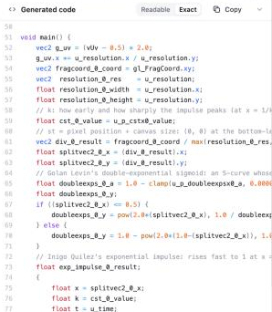
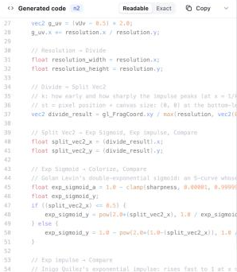

# Readable code

The **Generated code** panel (under the Studio graph) has a **Readable / Exact** switch.

- **Exact** is the code the graph compiles to, the program the preview runs. It is the default.
- **Readable** is the same program cleaned up for reading and copying. It compiles and draws the
  same picture.

The switch is remembered for the browser session (`sessionStorage`, key `codePanel_view`).

| Exact | Readable |
| --- | --- |
|  |  |

## What Readable changes

1. **Names come from the graph.** A node's variables take its label (its own name if you gave it
   one, else the card's title) plus the output: `circ_3_dist` → `circle_sdf_dist`. Two nodes with the
   same label get a short suffix (`circle_sdf2_dist`). Slider uniforms take their slider labels
   (`u_p_circx3_radius` → `radius`). When two sliders share a label, both carry their node's name
   (`circle_sdf_radius`, `circle_sdf2_radius`), as do one- and two-letter labels. `u_time`,
   `u_resolution` and `u_mouse` become `time`, `resolution` and `mouse`.
   New names never clash with each other or with any name already in the program, and are never a
   GLSL keyword, builtin, `gl_` name or a name with a double underscore.
2. **Grouped by node.** In `main()`, each node's statements start with a
   `// Label → what it feeds` header (`// Output → screen` for the Output). Statements keep the
   compiler's data-flow order, so nothing is reordered.
3. **Single-use copies are folded in.** `vec2 t = uv;` or `float k = 1.0;`, used once, is written
   in place of that use. This only happens at the top level of `main()`, and never when the name or
   its source is written to later, passed whole to a function of the shader's own (it may be
   `inout`), declared twice, or shares its line with a comment.
4. **Tidy formatting.** It uses single spaces, 4-space indents and at most one blank line in a row.
   Float literals lose trailing zeros (`1.00000` → `1.0`). Helper functions `main()` never reaches
   are left out, along with their comments.

The transform is `src/compiler/readableGlsl.ts`. It is a pure function of the compiled code and
the compiler's own maps:

- `nodeSlugMap` decides which node a name belongs to.
- `paramBindings` names the slider uniforms.
- `nodeOutputVars` assigns each output's variable to its node.

Renaming is a whole-token substitution over the whole program, so it can't change what the code
does.

## Line ↔ node

- **Click a line** to select its node in the graph. The canvas centres on the node.
- **Select a node** to highlight its lines. The panel scrolls to the first one in `main()`.

This works in both views. A line belongs to the node that owns the first name on it; a line inside
a block belongs to the statement that opened the block. Lines that name a selected node's slug are
highlighted as before.

## Safety

- If the GPU rejects the Readable program while Exact compiles, the panel shows Exact with a note.
- Graphs with a sealed node pack always show Exact, so the pack's code stays hidden.
- GLSL errors are marked on Exact's lines, because Exact is the code that runs.

**Copy** copies whichever view is showing. A Readable copy is a whole program (precision,
uniforms, helpers and `main()`), ready to paste elsewhere. Export is unchanged and always uses
Exact.

## Tests

`src/compiler/__tests__/readableGlsl.test.ts` covers:

- **Renaming:** it is deterministic, numbers clashes and uses user labels.
- **Reserved words:** keywords and builtins are never chosen as names.
- **Inlining safety:** used twice, written later, source changed in a loop, `inout` argument,
  trailing comment, inside a loop.
- **Formatting:** float trimming, indentation, and unused-helper removal.
- **Line ↔ node map:** each node gets its header and lines, and the Output owns the
  `gl_FragColor` line.

The test also runs every bundled example through Readable. In each one, the parser
(`@shaderfrog/glsl-parser`) must report no scope warning (an undeclared name, a missing function)
that Exact doesn't already have. For the examples the CPU runner (`glslRun.ts`) can run, both
programs draw three sample pixels and the results must match.
