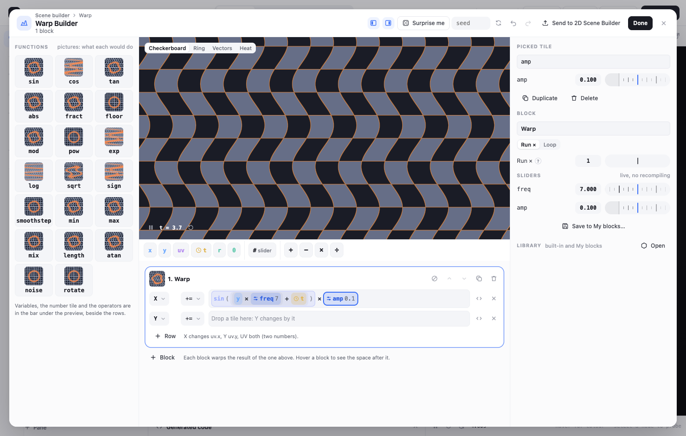
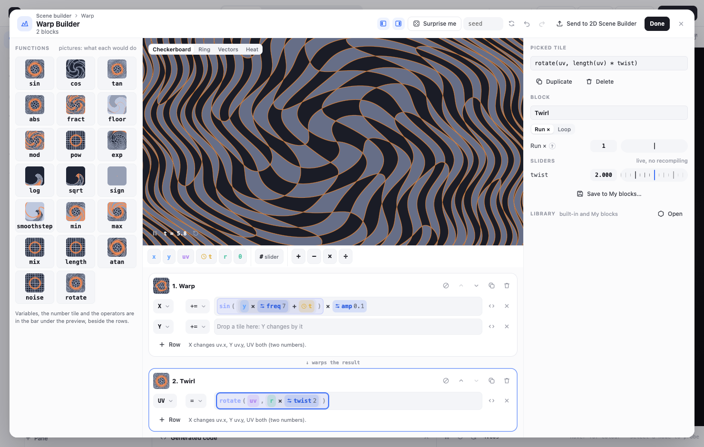
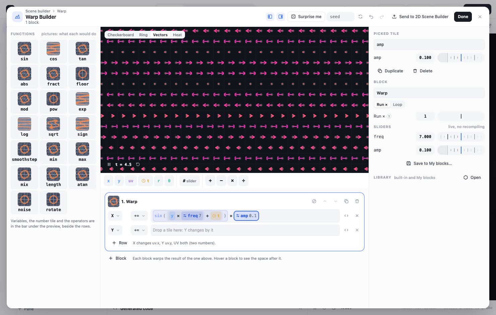
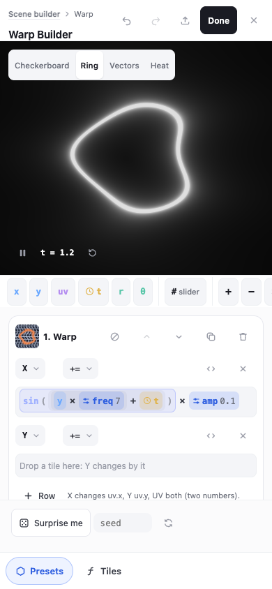

# Warp Builder

The Warp Builder is a page for building **space warps** by dragging tiles instead of typing code.
It is a function builder you can open like a scene. It is a kind on the Scene builder's kind page,
**Warp** ([scene-builder.md](scene-builder.md)). You can also open it from any space block in the
2D Scene Builder.

It builds the same thing as the 2D Scene Builder's **space blocks** ([scene-builder-2d.md](scene-builder-2d.md),
"Space blocks"). Each block is up to three lines, `uv.x ⊕= …`, `uv.y ⊕= …` and `uv ⊕= …`, with
sliders, Run × and the looped blocks with their loop variables and orbit traps. There is one format.
The tiles are another way of showing the block's lines, and every edit writes those lines back. So
a block made here works in the 2D builder, in My blocks and in recipes, and any of those blocks
opens here.

## The page

- **Left: the palette.**
  - **Variables:** `x`, `y`, `uv`, `t` (with a clock), `r` (`length(uv)`) and `θ`
    (`atan(y, x)`). A looped block also offers `i` (the pass, `fi`), `k`, `n` and `uv0`.
  - **The number tile (#):** a live slider.
  - **Functions:** sin, cos, tan, abs, fract, floor, mod, pow, exp, log, sqrt, sign, smoothstep,
    min, max, mix, length, atan, noise (`valueNoise`) and rotate. Each function tile has a picture:
    - when the picked row has tiles, a warped grid of what wrapping the picked tile in that function
      would do;
    - on an empty row, the function's curve.
  - **Operators:** + − × ÷.
- **Middle: the preview** of the whole stack, big and moving. The view switch has four views:
  - **Checkerboard** (the default): a warped grid;
  - **Ring:** a glowing white ring seen through the warp;
  - **Vectors:** an arrow from each cell's centre to where the warp sends it;
  - **Heat:** how far each point moves, with contour bands.

  Play/pause and back-to-0 for time are at the bottom left.
- **Under the preview: the blocks.** Each block has rows. Each row has:
  - which part it changes: **X** (`uv.x`), **Y** (`uv.y`) or **UV** (both);
  - its assign operator (`=`, `+=`, `-=`, `*=`);
  - its expression as tiles.

  A new block has an X row and a Y row (`+=`); **+ Row** adds a third. The `<>` button edits a
  row as text (the Expression Block line editor, with completions). The next block warps the
  result of the one above. **Hovering a block shows the space after it** in the preview.
- **Right: the picked tile, the block and the library.**
  - **The picked tile:** its text, editable (it turns back into tiles when it can). A number tile
    has its value and **Make a slider**. A slider has its slider.
  - **Duplicate** (⌘D): `tile + tile`.
  - **Swap**, on + − × ÷: swaps the two sides.
  - **Delete** (Delete or Backspace).
  - **The block:** its name, **Run ×** or **Loop** (Iterations), the orbit trap when looped, its
    sliders, and **Save to My blocks…**.
  - **The library:** the built-in blocks and My blocks. A pick adds a block to the stack.

## Building by dragging

Drag a palette tile onto a row, or onto a tile in a row. You can also click a palette tile: it
lands on the picked tile, or on the end of the first row.

| You drop | On | You get |
|---|---|---|
| a function | a tile | the tile wrapped: `x` → `sin(x)`. Functions with more slots fill the rest (`mod(x, 1)`, `pow(x, 2)`, `smoothstep(0, 1, x)`, `mix(x, _, 0.5)`, `rotate(uv, 0.5)`); noise wraps a number as `valueNoise(vec2(x, t))` |
| a function | an empty row, or the row's end | the whole row wrapped |
| an operator | a tile | `tile ⊕ _` (an empty slot to fill) |
| a variable or # | an empty slot or an empty row | it fills it |
| # | a filled tile | `tile × #`: it scales it |
| t (the clock) | a filled tile | `tile + t`: it makes it move |
| x, y, uv, r, θ… | a filled tile | it replaces it |
| any value | the row's end | `row + value` |
| a tile from a row | anywhere | it moves there (from another block, its sliders come along) |

So `uv.x += 0.1 * sin(y * 7 + t)` takes five drops: sin onto X, y into its slot, # onto y (`y × freq`),
the clock onto that (`y × freq + t`) and # onto the sin (`× amp`).

- **Numbers are sliders.** A # tile is a slider, named from where it lands:
  - **amp:** the front of a row's product;
  - **freq:** a factor inside sin, cos, fract or noise;
  - **speed:** a factor of `t`;
  - **shift:** in a sum;
  - **angle:** in rotate;
  - **power:** in pow;
  - **amount:** in mix.

  It starts somewhere sensible (amp 0.1, freq 7). Typing past a slider's end extends the range.
  Taking the last tile that reads a slider out of the block removes the slider.
- **After a drop** the next empty slot is picked, so the next click fills it.
- An empty slot is shown as **drop**, and the row says **Fill the empty slot**. In the text it is
  `_`. Like any row that doesn't check, the block leaves uv as it is until the slot is filled.
- Undo and redo (⌘Z, ⌘⇧Z) cover every edit.

## Text ↔ tiles

`textToTile` reads a line's right-hand side into tiles, and `tileText` prints tiles back
(src/warpBuilder/tiles.ts). Both are pure.

- `uv.x` reads as `x`; `length(uv)` and `atan(y, x)` read as the `r` and `θ` tiles.
- Unary minus on a number is a negative number tile.
- Whatever the tiles don't cover stays a **code tile** holding its text (shown amber). Click it to
  edit its text. This covers:
  - comparisons and ternaries (`x > 0.0 ? … : …`);
  - indexing;
  - names that aren't variables or sliders (PI, TAU);
  - text that doesn't parse.

Nothing is lost: a round trip from text to tiles and back is the same warp. The tests check this
at sample points for every library block.

## The stack and the preview

- **Blocks:** each block has a mute (the 2D builder's mute), earlier/later, duplicate and remove.
- **Run ×** (1–8) and **Loop** (1–64 iterations) work as they do in the 2D builder, including
  `uv0`, `fi`, `k`, `n` and the orbit trap.
- **The preview** is a small WebGL2 shader of its own (src/warpBuilder/preview.ts,
  src/components/warpBuilder/WarpPreview.tsx).
  - Every block is a function with a `for` loop up to 64.
  - Every number is a uniform: the sliders (`u_p`), Run × and Iterations (`u_n`), mute (`u_on`)
    and the hovered block (`u_upto`). So dragging a slider, muting or hovering never recompiles;
    only a change to the rows or to the view does.
  - A block that doesn't check is left out of the preview, as the 2D build leaves it out.

## Save, load, and the 2D Scene Builder

- **Save to My blocks…** saves the block to the same "My blocks" library the 2D builder uses
  (src/sceneBuilder2d/savedBlocks.ts), with its warped-grid picture. **Library → Open** lists the
  built-in blocks and My blocks; a pick adds a block.
- **Send to 2D Scene Builder** (top bar) adds the stack to the Space of the open 2D scene, or of a
  new one, and closes.
- **From the 2D Scene Builder:**
  - **Open in Warp Builder:** the wave button on any space block.
  - **Open stack in Warp Builder:** opens every block of the stack.

  It opens over the 2D builder. **Done: back to 2D** writes the blocks back in place of the ones
  it opened: the first keeps its id, extra blocks are added after it. Other space transforms
  (zoom, mirror, combines) stay where they are. ✕ closes without writing.
- **Done on its own** (opened from the kind page) builds a small graph with the 2D builder's own
  build:
  - a UV node;
  - each block as an Expression Block, sliders live;
  - for **Ring**: a white glowing ring (the default example's ring);
  - for Checkerboard, Vectors and Heat: the 2D builder's Output → **Space** look (a checkerboard
    and grid lines through the warp).

  It is a 2D build, so its UV node reopens it in the 2D Scene Builder.

## Surprise me

Surprise me makes a random block from the seed, and the same seed always makes the same block:

- one or two rows of `amp × f(source × freq + t)`, where f is sin, cos, a folded sine or noise,
  and the source is the other axis, r or θ;
- sometimes a twist row as well: `uv = rotate(uv, r × twist)`.

## On a phone

The palette is the **Tiles** tab, and taps replace dragging: tap a tile in a row to pick it, then
tap a palette tile. The tiles of a row go on a line of their own under its pickers. Send to 2D is
an icon.

## Code and tests

- **Code:**
  - src/warpBuilder/tiles.ts: tiles, text ↔ tiles, editing;
  - spec.ts: the stack, dropping, number tiles, Surprise, to and from the 2D space;
  - preview.ts: the preview shader;
  - store.ts, actions.ts;
  - src/components/warpBuilder/.
- **Tests:** src/warpBuilder/__tests__/warpBuilder.test.ts covers:
  - tiles ↔ lines round-trips;
  - every library block read into tiles, checked and the same warp;
  - building `uv.x += 0.1·sin(y·7+t)` by drops;
  - sliders, Run ×, mute and hover not changing the shader;
  - each preview view parsing as GLSL;
  - stacking and mute;
  - My blocks save and load;
  - opening from the 2D builder and writing back in place;
  - the standalone Done graph compiling for every view.

## Not yet

- **Combines:** a combine (two blocks joined) doesn't open here. *Open stack* opens the plain
  blocks around it and leaves it in place.
- **Saving the stack:** there is no "save the whole stack" as one My-blocks entry yet. Save works
  per block.
- **Touch:** no drag on touch screens; tap a tile, then tap a palette tile.
- **Ranges:** you can't set a slider's range other than by typing past its end (as everywhere).
